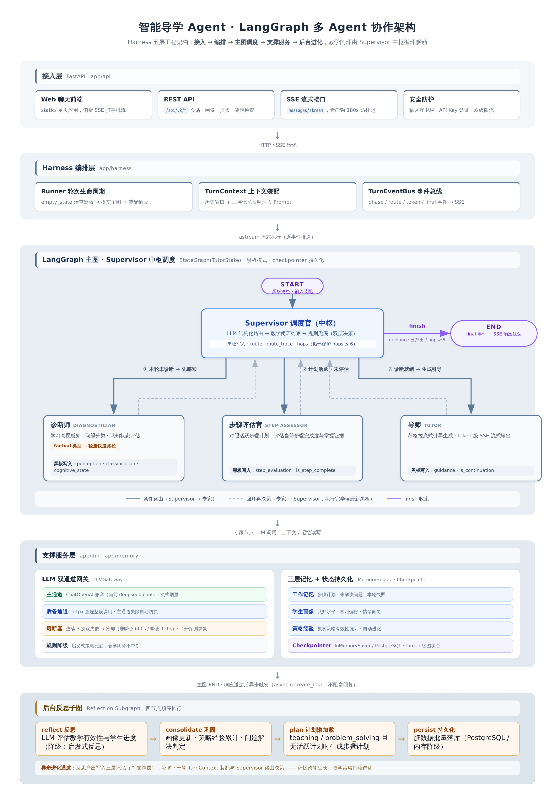
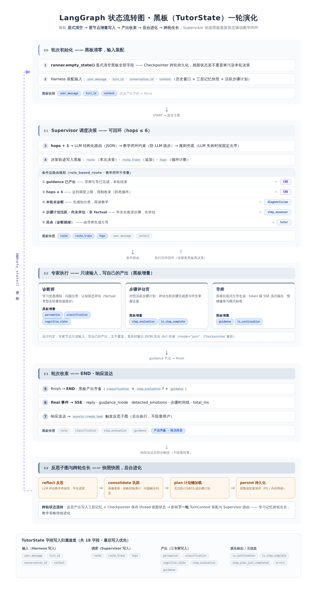

<div align="center">

# 智能导学 Agent

**Teaching Agent Harness** —— 基于 LangGraph 多 Agent 协作的个性化智能导学系统

像一位耐心的私教：诊断你的困惑、拆解学习步骤、陪伴练习、复盘进化教学策略


</div>

---

## 这是什么

一个把「教学理念」工程化的多 Agent 导学系统：Supervisor 调度四位专家 Agent（诊断师 / 步骤评估官 / 导师 / 反思进化师），在 LangGraph 主图上协作完成一轮教学，配合三层记忆框架让学生画像与教学经验跨会话生长。

它不是简单的「套壳 ChatBot」，核心差异在于：

- **教学闭环而非一问一答** —— 诊断意愿 → 拆解步骤计划 → 逐步引导评估 → 完成庆祝 → 后台反思进化，全程有状态机保障
- **步骤计划 complexity-first** —— 先判知识复杂度再定步数（2~6 步），同主题追问延续教学而非重启，学生没学会时「陪伴收尾」而非假称「已掌握」
- **全链路降级** —— LLM 主备双通道 + 熔断器 + 规则兜底，额度耗尽时教学流程依然不中断（一轮对话从 ~3s 降级延迟优化到 <0.1s）
- **多用户隔离** —— JWT 认证 + 会话/画像按用户键空间隔离，教学经验跨用户沉淀复用

---

## 核心特性

| 能力 | 说明 |
|------|------|
| 🎭 **多 Agent 协作** | Supervisor（LLM 路由 + 规则约束）调度诊断师、步骤评估官、导师、反思进化师，专家进出实时推送 SSE 动画 |
| 🧠 **三层记忆框架** | 工作记忆（会话状态+步骤追踪）/ 长期画像（白手起家，身份由对话发现）/ 策略经验（效果曲线进化）；PostgreSQL JSONB 持久化 + 脏标记批量写 |
| 📚 **教学经验库** | 反思效果 ≥0.65 按「主题×问题类型×引导模式」沉淀，EMA 去重合并，历代学习者验证过的教学策略跨用户复用 |
| 🪜 **步骤追踪器** | 原子步骤拆解、活跃计划强制延续、尝试 2 次自动推进「宁可推进不卡住」、最后一步陪伴收尾不假称掌握 |
| 🛡️ **全链路降级** | 双通道 LLM 网关（langchain-openai 主 + httpx 备）、熔断器（瞬态 120s / 非瞬态 600s 冷却）、Supervisor 规则路由兜底 |
| 🔐 **用户系统** | PBKDF2-HMAC-SHA256（12 万迭代）+ JWT + 注册/登录/改密 + 管理面板（用户管理/经验库/全局统计）+ 认证接口独立限流 |
| 🌊 **SSE 流式** | `phase → agent_enter/exit → route → token → final → done` 完整事件流，打字机输出 + rAF 合帧渲染 |
| 🧪 **30/30 测试** | 守卫栏 / 分类器 / 记忆 / 路由 / 教学闭环 / 用户隔离 / 步骤流专项，离线可跑无需 API Key |

---

## 架构总览

```
┌─────────────────────────────────────────────────────────────────┐
│                        FastAPI (API v2)                          │
│         REST /api/v2/*  +  SSE /messages/stream                  │
└──────────────────────────────┬──────────────────────────────────┘
                               │
┌──────────────────────────────▼──────────────────────────────────┐
│                     Harness 编排层（确定性）                      │
│  guardrails 输入守卫 → context 上下文装配 → runner 统一收口        │
│  events 事件总线(SSE) · policies 教学理念规则 · state 黑板         │
└──────────────────────────────┬──────────────────────────────────┘
                               │
┌──────────────────────────────▼──────────────────────────────────┐
│              LangGraph 主图（Supervisor 多Agent协作）              │
│                     ┌─────────────┐                              │
│        ┌────────────►│  Supervisor │◄───────────┐                 │
│        │             │ (LLM+规则)   │            │                 │
│   ┌────┴─────┐   ┌──┴────────┐ ┌───┴──────┐  ┌──┴───────┐       │
│   │ 诊断师    │   │ 步骤评估官 │ │   导师    │  │  finish  │→响应  │
│   │ 感知+分类 │   │  步骤评估  │ │ 三模式引导│  └──────────┘       │
│   └──────────┘   └───────────┘ └──────────┘                      │
└──────────────────────────────┬──────────────────────────────────┘
                               │ 响应送达后后台触发
┌──────────────────────────────▼──────────────────────────────────┐
│        反思后台子图：反思 → 记忆巩固 → 步骤计划懒加载 → 持久化       │
└──────────────────────────────┬──────────────────────────────────┘
                               │
┌──────────────────────────────▼───────────────┬───────────────────┐
│  三层记忆框架 + 教学经验库                      │  双通道 LLM 网关   │
│  工作记忆 · 长期画像 · 策略经验 · 经验沉淀        │  主 + 备 + 熔断    │
└───────────────────────────────────────────────┴───────────────────┘
```

**五层工程架构 + 主图拓扑** —— Harness 编排 / Supervisor 调度 / 专家协作 / 反思子图 / 记忆与网关：



**黑板状态一轮演化全景** —— TutorState 18 字段归属速查 + 5 条路由规则 + 跨轮闭环：



### Agent 分工

| Agent | 职责 |
|-------|------|
| **Supervisor** | LLM 路由决策 + 教学规则约束（诊断次序 / 步骤评估 / 收尾不变量，LLM 路由永不破坏教学闭环） |
| **诊断师** | 学习意愿三分法（eager / troubled / indifferent）+ 情绪感知 + 认知评估，factual 问题走轻量快速路径 |
| **步骤评估官** | 判定当前步骤完成度，「宁可推进也不要卡住」，最后一步自动收尾改为陪伴模式 |
| **导师** | 三模式引导：teaching→示例复现 / problem_solving→苏格拉底提问 / factual→直接回答+拓展；流式输出 |
| **反思进化师** | 后台子图：反思轮次效果 → 更新画像 → 沉淀教学经验 → 懒加载生成步骤计划（带过期快照守卫） |

### 三层记忆

| 层 | 存什么 | 生命周期 |
|----|--------|----------|
| 工作记忆 | 会话消息、步骤计划、图线程状态 | 会话内（Checkpointer 落库） |
| 长期画像 | 身份/年级/专业/课程/个性标签/参与度 | 跨会话（`p:{uid}` 按用户隔离，白手起家不预设） |
| 策略经验 | 引导模式效果曲线 + 教学经验库 | 跨用户沉淀（LRU 500 条，EMA 去重合并） |

---

## 快速开始

```bash
# 1. 克隆 & 配置
git clone <your-repo-url> && cd teaching-agent-harness
cp .env.example .env          # 编辑 .env 填入 LLM_API_KEY

# 2.（可选）启动 PostgreSQL 记忆持久化；不启动自动降级纯内存模式
docker compose up -d

# 3. 安装依赖并启动
pip install -r requirements.txt
python -m uvicorn app.main:app --host 0.0.0.0 --port 8000
# 或一条龙：./start.sh --install
```

打开 <http://localhost:8000>，注册账号即可开始教学对话（首个管理员由 `ADMIN_BOOTSTRAP_*` 引导创建）。

### 关键配置（`.env`）

| 变量 | 说明 | 默认 |
|------|------|------|
| `LLM_API_KEY` | LLM 密钥（DeepSeek / Qwen / 豆包 / OpenAI 兼容接口均可） | 无必填 |
| `LLM_BASE_URL` | 接口地址，如 `https://api.deepseek.com/v1` | — |
| `LLM_MODEL` | 模型名，如 `deepseek-chat` | — |
| `DATABASE_URL` | PostgreSQL 连接串（compose 映射 `localhost:5433`） | 空=纯内存 |
| `AUTH_REQUIRED` | `true` 强制登录；`false` 允许 guest 访客 | false |
| `AUTH_ALLOW_REGISTRATION` | 是否开放注册 | true |
| `ADMIN_BOOTSTRAP_USERNAME/PASSWORD` | 无管理员时自动引导创建的首个管理员 | admin |

### 离线验证（无需 API Key）

```bash
pytest tests/ -q    # 全量 30/30：v4.x 回归 + v5.0 用户隔离 + v5.3 步骤流专项
```

---

## API 速览

```text
教学    POST /api/v2/conversations/{cid}/messages            JSON 完整响应
        POST /api/v2/conversations/{cid}/messages/stream     SSE 流式（推荐）
步骤    GET  /api/v2/conversations/{cid}/steps               步骤进度
        POST /api/v2/conversations/{cid}/steps/skip          跳过当前步骤
会话    GET  /api/v2/conversations                           我的会话列表
画像    GET  /api/v2/profile                                 长期画像
认证    POST /api/v2/auth/register|login|change-password     注册/登录/改密
管理    GET/POST/PATCH/DELETE /api/v2/admin/*                用户/经验库/统计（admin）
运维    GET  /api/v2/health                                  健康检查（含熔断状态）
```

SSE 事件流：`phase → agent_enter/exit → route（调度决策+理由）→ token（打字机）→ final → done`

---

## 可靠性设计

教学闭环在任何一层故障下都不中断：

| 场景 | 行为 |
|------|------|
| PostgreSQL 不可用 | 自动降级内存模式（功能完整，重启丢记忆） |
| 主 LLM 通道失败 | 自动切换 httpx 后备通道 |
| 双通道均失败 | 规则路由 + 规则分类 + 启发式评估 + 降级引导，教学流程继续 |
| 双通道连续失败 ≥3 次 | 熔断冷却（瞬态 120s / 额度耗尽 600s），期间零网络请求直接规则降级，半开探测自动恢复 |
| 步骤计划生成失败 | 按复杂度规则生成兜底计划（2~5 步） |
| 后台反思挂起 | SSE 看门狗 180s 超时兜底，客户端永不永久等待 |

> 真实场景实测：LLM 额度耗尽（403）后，熔断器将降级模式一轮对话耗时从 ~3s 压到 <0.1s，教学流程零中断。

---

## 教学理念速览

| 理念 | 落点 |
|------|------|
| 学习意愿三分法（渴望/困惑/冷漠）差异化应对 | 诊断师 Prompt + 规则分类兜底 |
| teaching→示例复现 / problem_solving→苏格拉底 / factual→直答+拓展 | 导师三模式 |
| 步骤计划 complexity-first（simple 2-3 / medium 3-4 / complex 5-6 步） | 反思进化师 + 校验告警 |
| 「宁可推进也不要卡住」，尝试 2 次自动推进 | 步骤评估官 |
| 学生没学会时不假称「已掌握」，陪伴收尾给完整示范 | v5.3 陪伴收尾模式 |
| 同主题追问延续教学，明确说「从头再教」才重启计划 | v5.3 同主题跟进守卫 |
| 鼓励语贴切不空洞，按挫败感/参与度生成 | policies 逐字移植 |
| 反思→画像更新→策略进化→经验沉淀 | 反思后台子图 |

---

## 目录结构

```text
app/
├── auth.py              # 用户系统（PBKDF2 / JWT / UserManager）
├── harness/             # Harness 编排层：state 黑板 · scoping 隔离键 · graph 主图
│                        #   reflection 反思子图 · runner 收口 · policies 教学规则
│                        #   context 装配 · guardrails 守卫 · events 事件总线
├── agents/              # supervisor · diagnostician · step_assessor · tutor · reflector
├── memory/              # working · profile · strategy · experience · consolidator · persistence
├── llm/                 # gateway（双通道+熔断）· primary · fallback
├── prompts/             # 教学理念 Prompt 模板
├── models/              # 领域模型 / API 模型 / 用户模型
├── api/                 # API v2 路由 + SSE + 认证/管理路由
└── main.py              # FastAPI 入口
static/                  # 前端三件套（原生 JS，零构建）
tests/                   # 30 项离线测试 + 真实 LLM e2e 脚本
docs/                    # 设计文档 + 两张高清架构图
```

---

## 版本演进

| 版本 | 主题 |
|------|------|
| v4.1 | 深度优化：LLM 熔断器 / SSE 看门狗 / 教学闭环路由约束 / 前端渲染优化 |
| v4.3 | 回复卫生：轮次重复输出治理 / 进度行单一渲染 |
| v5.0 | 多用户版：用户系统 / 画像会话隔离 / 教学经验库 |
| v5.1 | 部署修复：PostgresSaver 启动降级（事务块冲突） |
| v5.2 | 白手起家画像：移除预设画像，身份由对话发现 |
| v5.3 | 步骤流修复：陪伴收尾 / 同主题跟进延续 / complexity-first 步数 / 反思竞态守卫 |

详细的修复过程与根因分析见仓库 [`README.md`](README.md)（工程日志版）。

---

## License

MIT

---
*AI生成*
